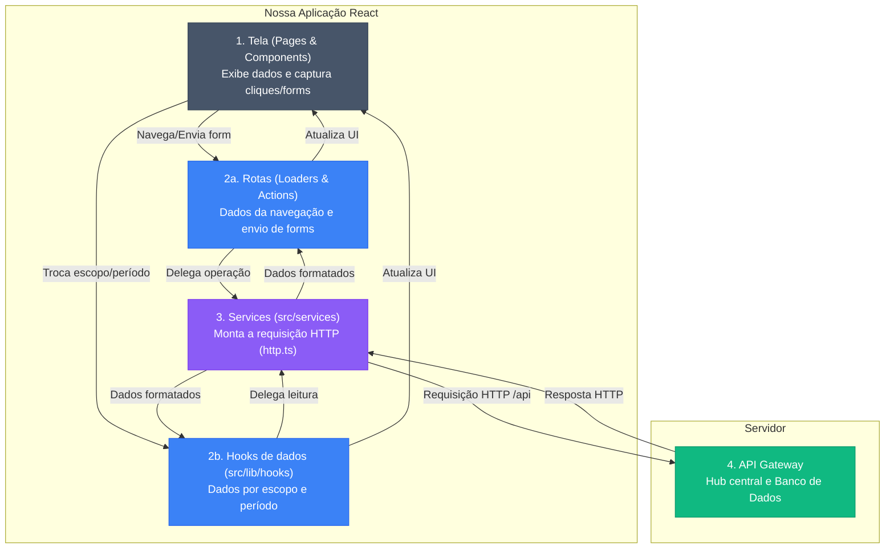

# Frontend - Arquitetura e Estrutura

Este documento explica como o frontend funciona, como as pastas estão organizadas e como os dados viajam entre a tela do usuário e o servidor.

## O Caminho dos Dados (O Fluxo Completo)

O sistema usa o React Router v7 (`createBrowserRouter`, em `src/routes/source.tsx`) para gerenciar o tráfego de dados. Nenhuma tela chama `fetch` direto: toda chamada à API passa por um **service** de `src/services/`, que usa os helpers de `src/lib/utils/http.ts`. O ESLint garante isso — `fetch('/api/...')` fora do `http.ts` é erro (`no-restricted-syntax` em `eslint.config.js`).

O caminho principal até o service tem três passos (as exceções estão em "O que isso significa na prática"):

1. **Tela (UI):** Captura a ação do usuário (acessar uma página ou enviar um form).
2. **Rota (Loader/Action)** ou **hook de dados (`src/lib/hooks`)**: a rota cuida do que é carregado na navegação e do que é enviado por formulário; o hook cuida dos dados que mudam com o escopo e o período escolhidos no header da área logada, buscados no cliente sem trocar de rota.
3. **Serviço (Service):** Monta a requisição HTTP (URL, método, body) e fala com a API.



### O que isso significa na prática ?

- **Para ler (Loaders):** Quando o usuário acessa o dashboard, o `LoaderUserDashboard` chama, em paralelo, os helpers de `src/routes/load/` (`loadFeedbackStatsData`, `loadQrCodeEnterpriseData`), que chamam os services (ex.: `ServiceGetFeedbackStats`). O **Service** monta a URL e faz o GET no Gateway (a sessão vai no **cookie httpOnly**, enviado automaticamente via `credentials: 'include'`), trata possíveis erros HTTP e devolve o JSON limpo. A tela lê o resultado com `useLoaderData()`; os dados do usuário e da empresa, carregados pelo loader da rota pai `/user` (`LoaderUserProtected`), chegam por `useRouteLoaderData('user')`.

- **Para ler por escopo (Hooks):** O escopo (Geral, produto, serviço, departamento), o item do catálogo e o período ficam no contexto `insightsControls`, que o `layouts/user.tsx` provê. Hooks como `useScopedInsightsReport`, `useScopedStats` e `useScopedFeedbackAnalysis` leem esse contexto, chamam o service e recarregam quando ele muda. A página `/user/insights/overview`, por exemplo, não tem loader: tudo vem do `useScopedInsightsReport`.

- **Para escrever (Actions):** O usuário preenche um `<Form>` (ou um `useFetcher`) e submete. A `action` (ex.: `ActionCollectingData`) extrai os dados do formulário e chama o service correspondente em `serviceEnterprise.ts`, que faz o POST/PATCH. A `action` apenas recebe a confirmação e avisa a tela. Quando uma rota tem mais de uma operação, a `action` despacha pelo campo `intent` (constantes em `src/lib/constants/routes/intents.ts`) — ex.: `ActionFeedbackGeneralPage` repassa para `ActionQrCodeEnterprise` ou `ActionFeedbackSettings`.

- **Chamadas pontuais:** algumas telas e componentes chamam o service direto, sem rota nem hook — ex.: `pages/user/ratings.tsx` e `pages/user/compare.tsx` (`ServiceGetFeedbackStats`), `pages/user/diagnosis.tsx`, `pages/user/openrouterCallback.tsx`, `DeleteAccountSection` e `CommentFieldSettings`. Mesmo assim, o `fetch` continua só no `http.ts`.

- **Endereço da API:** os services chamam caminhos relativos `/api/...`. Em produção, a Web chama o próprio domínio e a Vercel repassa `/api/*` ao gateway (`rewrites` do `vercel.json`); localmente, com `VITE_API_BASE_URL` vazia (padrão do `.env.example`), o proxy do `vite.config.ts` repassa `/api → http://localhost:3000`. As rotas públicas que contam por IP (formulário do cliente e reenvio da confirmação) usam `requestPublicApi`/`postPublicJson`, que vão direto ao gateway por `VITE_PUBLIC_API_BASE_URL`, sem cookie. As variáveis estão no `.env.example`; a sessão, no [Fluxo de autenticação](./fluxo-autenticacao.md).

## As 4 Camadas do Sistema
Para manter o código fácil de dar manutenção, separamos as responsabilidades:

1. **Páginas (`pages/`)** — Arquivos que juntam componentes para formar uma tela completa. Pegam os dados das rotas (ou dos hooks de dados) e repassam para os filhos. A regra de negócio fica em `src/lib/utils` e nos hooks.

2. **Componentes (`components/`)** — Blocos visuais reaproveitáveis (botões, cards, gráficos). Recebem propriedades (props) e emitem eventos. Os primitivos de interface (`components/ui/`: dialog, select, switch, toast…) são componentes próprios, sem biblioteca de UI.

3. **Rotas (`src/routes/`)** — **Os Controladores:** Onde vivem Loaders e Actions. Eles conectam a tela ao motor de dados. A árvore de rotas fica em `source.tsx` (raiz), `public.tsx` e `user.tsx`.

4. **Infraestrutura (`src/services/` + `src/lib/utils/http.ts`)** — **O coração da comunicação**. Os services montam as URLs da API; o `http.ts` centraliza o `fetch` (`requestApi`, `getJson`, `postJson`, `patchJson`, `putJson`) com `credentials: 'include'` (a sessão vai no **cookie httpOnly** — não há injeção de token) e transforma resposta não-OK em erro com `status` e `code`.

### Convenções que o lint cobra

- **Sem `fetch` direto para `/api`:** use `requestApi(...)` de `src/lib/utils/http` (regra em todo `.ts`/`.tsx`).
- **Tipos de apresentação em `ui.types.ts`:** em `components/` e `pages/`, `interface` e `type` só podem ser declarados no `ui.types.ts` da pasta; o componente importa de lá. Os tipos de domínio e de contrato vêm do `@feedback/lib-shared`.

### Aliases de import

Definidos no `vite.config.ts` (`resolve.alias`) e no `tsconfig.json` (`paths`):

| Alias | Aponta para |
|---|---|
| `src/*`, `pages/*`, `layouts/*`, `components/*`, `styles/*` | As pastas de mesmo nome na raiz |
| `lib/utils/*`, `lib/constants/*` | `src/lib/utils` e `src/lib/constants` |
| `lib/*` (o resto) | `node_modules/@feedback/lib-shared/dist` — contratos, entidades e schemas compartilhados |

## Onde Encontrar Cada Arquivo
```
feedback-analytics-web/
├── src/
│   ├── main.tsx                → Ponto de entrada (monta o <Source /> e importa styles/imports.css)
│   ├── routes/                 → Orquestradores (Loaders, Actions e a árvore de Rotas)
│   │   ├── source.tsx          → Roteador raiz (createBrowserRouter, ErrorPage, FallbackType01)
│   │   ├── public.tsx          → Rotas públicas (layout público)
│   │   ├── user.tsx            → Rotas /user/* (layout autenticado, LoaderUserProtected, redirects de rotas antigas)
│   │   ├── actions/            → Funções de mutation (POST, PATCH, DELETE), algumas despachando por intent
│   │   ├── loaders/            → Funções de leitura (GET), uma por rota
│   │   └── load/               → Helpers compartilhados chamados pelos loaders e por alguns hooks
│   ├── services/               → Serviços HTTP (onde as requisições são montadas)
│   │   ├── serviceAuth.ts
│   │   ├── serviceCollectionPoints.ts
│   │   ├── serviceCommentField.ts
│   │   ├── serviceEnterprise.ts
│   │   ├── serviceFeedbackQRCode.ts
│   │   ├── serviceFeedbacks.ts
│   │   ├── serviceIaConfig.ts
│   │   ├── serviceScopeDiagnosis.ts
│   │   ├── serviceSystemGuide.ts
│   │   └── serviceUser.ts
│   ├── hooks/                  → Hooks avulsos (useIaModels, useResendConfirmationCooldown)
│   └── lib/
│       ├── constants/          → Constantes de domínio (catálogo, escopos, ajuda, métricas, textos legais) e routes/ (errors, intents, routeMeta)
│       ├── context/            → Contextos React (insightsControls, onboardingContext, companyQuestionsGenerationContext)
│       ├── hooks/              → Hooks de dados por escopo (useScopedStats, useScopedInsightsReport, useScopedFeedbackAnalysis…) e de operação da IA (useIaOperation, useAnalysisJobPolling)
│       ├── constants/          → inclui menu.ts: definição do menu da área logada (usada pelo Menu, HeaderNav e sectionSiblings)
│       └── utils/              → Utilitários puros (formatação, validação, estatística, http)
├── pages/                      → Montagem das telas (composição de componentes)
│   ├── public/                 → Páginas públicas (home, login, register, senha, termos, privacidade, qrcode)
│   ├── user/                   → Páginas autenticadas (dashboard, ratings, compare, diagnosis, profile, feedbacks, insights, questions, edit…)
│   └── tests/                  → Testes das páginas (ver pages/tests/README.md)
├── layouts/                    → Layouts base (public.tsx e user.tsx) e seus testes (tests/)
├── components/
│   ├── fallbacks/              → Componentes de fallback de carregamento
│   ├── globals/                → Componentes globais (ex: errorPage)
│   ├── svg/                    → Ícones e imagens SVG inline
│   ├── ui/                     → Primitivos de interface (checkbox, dialog, input, select, sidebar, spinner, switch, toast…)
│   ├── public/                 → Componentes da área pública
│   │   ├── forms/              → Formulários (login, register, complete signup, qrcode, forgot/reset password, reenvio da confirmação) e seus campos
│   │   ├── layout/             → Header público
│   │   ├── legal/              → Página de termos e privacidade
│   │   ├── qrcode/enterprise/  → Formulário público e seus estados (error, submitted, feedback já enviado…)
│   │   └── shared/             → Peças comuns da área pública (AuthShell, card)
│   └── user/
│       ├── layout/             → Estrutura base autenticada (Menu, Sidebar, Header, navegação mobile, barra de ações da IA)
│       ├── onboarding/         → Configuração inicial, tour guiado e diálogos de contexto da IA
│       ├── shared/             → Peças comuns (Cards, Avatares, Skeletons, Badge), wayfinding (PageHeader, SectionTabs), selos (PrecisionBadge, ScopeTag, PeriodDelta), ajuda contextual (HelpPopover, HelpHint, MetricHelp) e seletor de modelo da IA
│       └── pages/              → Peças específicas de cada tela
│           ├── catalog/
│           ├── commentField/
│           ├── comments/
│           ├── compare/
│           ├── dashboard/
│           ├── diagnosis/
│           ├── edit/           → Skeleton da tela de clientes (EditCustomersSkeleton)
│           ├── feedbacks/
│           │   └── insights/   → Skeleton da visão geral dos comentários
│           ├── feedbacksAll/
│           ├── feedbacksInsightsReport/
│           ├── profile/
│           ├── qrcodeCatalog/  → Só ui.types.ts
│           ├── qrcodeEnterprise/
│           └── questions/
├── styles/                     → Estilos (Tailwind v4 em tailwind.css, index.css e imports por área: public/ e user/)
└── tests/setup.ts              → Setup global do Vitest
```

## Tipos de Entidade: `Enterprise` vs `EnterpriseContext`

O frontend usa dois tipos TypeScript distintos para representar a empresa — cada um com uma responsabilidade clara.

### `Enterprise` (de `@feedback/lib-shared`, via alias `lib/interfaces/entities/enterprise.entity`)

Representa exatamente o que existe na tabela `public.enterprise` do banco de dados:

```typescript
interface Enterprise {
  id: string;
  terms_version?: string;
  terms_accepted_at?: string | null;
  created_at: string;
  trial_ends_at: string | null;
  subscription_status: 'TRIAL' | 'ACTIVE' | 'EXPIRED' | 'CANCELED';
}
```

### `EnterpriseContext` (mesmo arquivo, exportado como `type`)

É o tipo composto usado pelos componentes do dashboard — `Enterprise` mais os campos do usuário autenticado (e-mail, telefone, nome), que vêm da resposta `GET /api/protected/user/auth_user` do gateway e são mesclados no loader:

```typescript
type EnterpriseContext = Enterprise & {
  full_name: string | null;
  email: string | null;
  phone: string | null;
};
```

### Por que essa separação?

`full_name`, `email` e `phone` não existem na tabela `enterprise` — eles pertencem ao usuário autenticado e chegam pela resposta `auth_user` do gateway. O helper `loadUserContextData` (`src/routes/load/loadUserContext.ts`, chamado pelo `LoaderUserProtected` da rota `/user`) faz o merge antes de entregar os dados para as rotas. Se a conta ainda não tem empresa, ele monta um `Enterprise` vazio (`subscription_status: 'TRIAL'`) com os mesmos três campos:

```typescript
const enterprise: EnterpriseContext = {
  ...enterprisePayload.enterprise,
  email: user.email ?? null,
  phone: user.phone ?? null,
  full_name: user.user_metadata?.full_name ?? null,
};
```

**Regra prática:** use `Enterprise` ao tipar dados que vêm diretamente da API/banco. Use `EnterpriseContext` em componentes de UI que precisam exibir nome, e-mail ou telefone do gestor junto com os dados da empresa.
